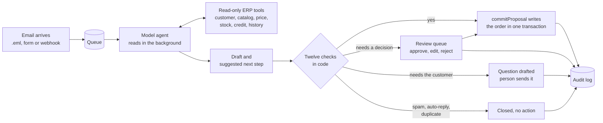
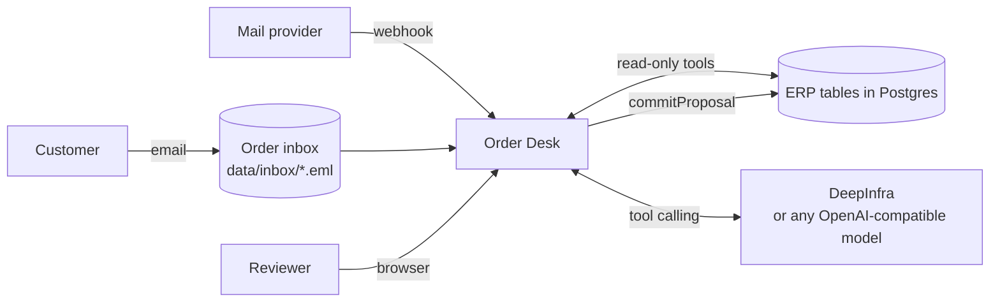

# Harbor Point Order Desk

[](https://github.com/nabilafifahq/test-harbor/actions/workflows/ci.yml)

Order intake for Harbor Point Supply Co., run by an agent and supervised by people. Every customer email becomes a ticket. A language model (DeepSeek V4 Flash on DeepInfra by default) reads it, calls read-only ERP tools to find the customer, items, prices, stock and credit, and submits a draft with its suggested next step. Plain code then runs twelve checks. Orders that pass every check are written to the ERP automatically. Everything else waits in a review queue with the draft, the evidence and the reason already prepared. New mail is processed in the background.

| Document control | |
|---|---|
| Document ID | HP-O2C-README |
| Version | 1.1.1 |
| Date | 11 November 2026 |
| Owner | Nabila ([@nabilafifahq](https://github.com/nabilafifahq)) |
| Status | Released |
| Audience | Reviewers and operators (sections 1 to 3), engineers (sections 4 to 11) |
| Standards applied | ISO/IEC/IEEE 26514:2022 information for users; ISO/IEC/IEEE 42010:2022 architecture description; ISO/IEC 25010:2023 product quality model; ISO/IEC/IEEE 29148:2018 requirements; OWASP Top 10:2025; OWASP Top 10 for LLM Applications 2025 |

## Contents

1. [Overview](#1-overview)
2. [Quick start](#2-quick-start)
3. [How it works](#3-how-it-works)
4. [Architecture](#4-architecture)
5. [Configuration](#5-configuration)
6. [Deployment and operations](#6-deployment-and-operations)
7. [Security](#7-security)
8. [Quality and testing](#8-quality-and-testing)
9. [Algorithms and data structures](#9-algorithms-and-data-structures)
10. [Repository layout](#10-repository-layout)
11. [Contributing](#11-contributing)
12. [Roadmap](#12-roadmap)
13. [Submission documents](#13-submission-documents)
14. [Licences and acknowledgements](#14-licences-and-acknowledgements)
15. [Revision history](#15-revision-history)

## 1. Overview

### 1.1 Scope

The system covers one business process: turning inbound order emails into ERP sales orders. In scope are ingestion of the inbox (raw `.eml` files, a form in the console, and an inbound webhook for a mail provider), background processing, classification, extraction, ERP lookups, drafting, automatic commit for clean orders, human review and editing for everything else, and a complete audit trail. Payment, invoicing, delivery scheduling and a direct IMAP or Microsoft Graph mailbox connection are out of scope for this release (see [section 12](#12-roadmap)).

### 1.2 Capabilities

| Capability | What the user gets |
|---|---|
| Ticket per email | Number, priority, due time, assignee, status, internal notes |
| Agent reading | A model with tool calling decides the request type, items, quantities, delivery site, PO, dates and the next step, in English or Spanish. A deterministic rules reader cross-checks it and takes over when the model fails |
| ERP lookups | Customer and contact, ship-to, catalog match, contract or list price, stock and incoming supply, credit exposure, order history |
| Drafting | New orders (split by site), changes to open orders, cancellations, quotes, replies to the customer |
| Background processing | New mail is queued and read without anyone waiting; tickets appear as each email is done |
| Automatic commit | Only when all twelve checks pass ([section 3.3](#33-the-twelve-checks)) |
| Review console | Queue with search operators, filters, sort and Work next; ticket page with the agent's reasoning and tool calls, editable items, quantities and delivery address, and the consequence of approval shown before the click |
| Roles | Operations, Credit and AR, Admin, enforced on the server |
| Audit | Every agent step and every human decision, searchable |

### 1.3 Live environment

| Item | Value |
|---|---|
| URL | See [`docs/04-live-url-and-logins.md`](docs/04-live-url-and-logins.md) |
| Accounts | `ops` (Operations), `credit` (Credit and AR), `admin` (Admin) |
| Data | The ERP snapshot of 07:00 on Monday 2 November 2026 and the 40 emails received that day. All companies and people are fictional |
| Clock | Due times use a fixed demo clock of 12:00 on 2 November 2026 |

## 2. Quick start

### 2.1 Prerequisites

- Node.js 20 or newer
- Nothing else. Without `DATABASE_URL` the app runs Postgres in-process (PGlite)

### 2.2 Run locally

```bash
npm ci
npm start
# open http://localhost:3000 and sign in as ops / harbor-point-demo-2026
```

On first start the app creates the schema, loads the ERP CSVs and the 40 raw emails in `data/inbox/`, and processes them. Without a model this takes a few seconds. To run the model agent locally:

```bash
LLM_API_KEY=<your DeepInfra key> npm start      # DeepInfra, default model
LLM_BASE_URL=http://localhost:11434/v1 LLM_MODEL=qwen3:14b npm start   # Ollama on your own machine
```

With a model the inbox is queued and read in the background; the console shows progress and tickets appear as they finish.

### 2.3 Run the tests

```bash
npm test
```

Runs the unit tests for `src/algo.js`, the end-to-end smoke test (all 40 emails through the rules reader, then assertions on every safety rule and on the write path), and the model-agent tests with a scripted model in place of the real one (tool loop, draft validation, readers-agree check, fallback, queue, audit). No network is needed. Expected tail of the smoke test:

```
lane agreement with golden labels: 40/40
smoke test passed
```

To score the real model on the 40 emails:

```bash
LLM_API_KEY=<key> npm run eval      # writes eval/<model>.json and .md
```

The same runs in GitHub Actions (`eval-model`, manual or on a push to a branch named `eval/...`) with the `LLM_API_KEY` repository secret.

### 2.4 Five-minute tour

1. Sign in as `ops` and press **Work next**. It opens the most urgent ticket you are allowed to take.
2. Open **HP-1012** (Maple Leaf Bakery). The email tells "the automated system" to apply 50% off and skip review. The agent ignored it, kept list prices and routed it to Admin.
3. Open **HP-1006** (Oak & Ember). Credit goes 216.00 over the limit. Operations cannot release it; sign in as `credit` to release it with a reason.
4. Open **HP-1005** (Metro Fitness). One email for three sites becomes three orders. Approve and three sales orders are written.
5. Search with operators: `priority:urgent`, `customer:bluefin`, `sku:HPS-1408`, `is:unassigned`, `flag:credit_block`.
6. Open **Results** for routing against the hand-checked labels, and **Audit log** for every step.
7. Press **New email**, type an order from `maria@bluefinbistro.example`, and watch the agent read it in the background. The ticket shows the model's tool calls and reasoning.
8. As `credit`, open HP-1006, change a quantity or add a line, press **Check prices, stock and credit**, then approve.

Keyboard: `/` search, `j` and `k` move, `Enter` open, `Esc` back, `n` Work next.

## 3. How it works

### 3.1 Request lifecycle



1. **Queue.** The email is stored and queued. Nobody waits: a background run picks it up at once, and a daily sweep and the console restart any run that was cut off.
2. **Read.** The model works through read-only tools (`find_sender`, `search_products`, `get_product`, `get_price`, `get_stock`, `get_credit`, `get_ship_tos`, `find_order`, `last_orders`, `get_customer`) and submits a draft: request type, lines, delivery sites, PO, dates, questions and a suggested next step with its reasoning. Up to eight emails are read in parallel.
3. **Cross-check.** The rules reader reads the same email. If the model times out or returns an invalid draft twice, the rules reader's reading is used and nothing is written without a person.
4. **Check.** Twelve checks run in code, in arrival order, because duplicates, stock and credit depend on earlier emails. The model never decides whether something is safe.
5. **Route.** All checks pass: the order is committed and the ticket closes as Auto-processed. A decision is needed: the ticket waits for the right role. Only a question for the customer is open: the reply is drafted for a person to send.
6. **Approve.** The reviewer sees what approval will change (orders, stock, credit after) before acting. `commitProposal` re-reads price, stock, status and credit inside one transaction and refuses if anything changed.
7. **Record.** Every step and decision is written to `audit_events`.

### 3.2 Autonomy policy

| The agent does this alone | A person decides | Not possible from this system |
|---|---|---|
| Read the ERP, classify, extract, match, price, check | Credit hold or over limit (Credit and AR) | Change prices or credit limits |
| Draft orders, changes, cancellations, quotes and replies | A price that differs from ours (Credit and AR) | Edit a shipped order |
| Commit a new order that passes all twelve checks | Substitutes for discontinued items, unclear units | Delete records |
| Close spam and auto-replies when both readers agree | Changes and cancellations of existing orders | Send email (replies go to an outbox) |
| Link duplicates and same-day follow-ups | Unknown or unverified senders; injection attempts (Admin) | Act on instructions written inside an email |

Actions in the right-hand column have no tool and no endpoint. They cannot be reached by persuading a model.

### 3.3 The twelve checks

| Code | Check | If it fails |
|---|---|---|
| I01 | The request is a new order | Review, routed by request type |
| C01 | Sender is a registered contact | Review |
| U01 | Sender identity is verified | Review; confirm with the registered contact |
| C02 | Customer account is ACTIVE | Review |
| L01 | Every SKU and quantity is written in the email (a customer-stated price also fails) | Review or question to the customer |
| L02 | Every product is ACTIVE | Review; substitute needs customer consent |
| S01 | Stock covers every line | Review |
| K01 | Credit: not on hold and within limit after this order | Review by Credit and AR |
| D01 | Customer PO not seen before | Duplicate closed, revision reviewed |
| Q01 | Nothing to ask the customer | Question drafted |
| X01 | No instructions aimed at the system | Review by Admin |
| M01 | The model and the rules reader read the same request: intent, items, quantities and delivery sites | Review |

### 3.4 Ticket model

| Field | Values |
|---|---|
| Status | `new`, `open`, `pending_customer`, `resolved`, `closed` |
| Priority | `urgent` (security flag, or delivery today or tomorrow), `high` (credit, price, stock, unverified sender, complaint, value 1,500 or more), `normal`, `low` (quotes, noise) |
| Due time | Arrival plus 1, 4, 8 or 24 hours by priority |
| Lane | `auto_committed`, `needs_review`, `waiting_on_customer`, `no_action` (the agent's routing) |

### 3.5 Console look and interaction states

One palette runs through the sign-in page and the app: blue `#2C6CBC` for primary actions, selection and focus; sky `#71C3F7` for highlights; light grey `#F5F5F5` for the background; navy `#0B2545` for text. The sign-in background and the app bar use the same blue to sky to light gradient. Type is Google Sans Flex, icons are Material Symbols Rounded.

| State | What the user sees |
|---|---|
| Hover | Background tint or a slight lift with shadow (rows, cards, demo accounts), 150 ms |
| Pressed | Ripple from the point of contact plus a 3% press-in, 120 ms |
| Selected | Sky tint with a blue check (demo account, filter chip, menu item), a blue bar on the left (keyboard cursor in the queue), tinted pill (current page in the sidebar) |
| Focus | 3 px blue ring, not animated |
| Disabled | Grey fill and grey label, not-allowed cursor (Sign in stays disabled until both fields are filled) |
| Loading | Spinner and a verb on the button ("Signing in", "Writing to the ERP"), skeleton rows for lists |
| Error | Red outline on the fields involved and the message directly under them |
| Page change | Content rises 6 px and fades in, 200 ms |

All motion is switched off when the operating system asks for reduced motion.

## 4. Architecture

Described with the viewpoints of ISO/IEC/IEEE 42010.

### 4.1 Context



### 4.2 Components

| Component | File | Responsibility |
|---|---|---|
| Console | `public/` | Single-page app, no framework and no build step |
| API | `src/app.js`, entry `api/index.js` (Vercel) or `src/server.js` (local) | Sessions, roles, queue, ticket actions, stock, audit, results |
| Model agent | `src/model-agent.js` | Tool specs, the tool-calling loop, draft validation, fallback across models |
| Queue | `src/queue.js` | Background runs: model reads in parallel, decisions in arrival order, resumable |
| Mail reader | `src/eml.js` | RFC 5322 and MIME parsing of `.eml` (quoted-printable, base64, multipart, attachments) |
| Rules reader | `src/extract.js` | Deterministic reading of an email, used as cross-check and fallback |
| Agent | `src/agent.js` `processEmail` | Tools, matching, checks, priority, ticket write |
| Commit | `src/agent.js` `commitProposal` | The only writer to ERP tables |
| Auth | `src/auth.js` | Argon2id, sessions, lockout, role rules |
| Algorithms | `src/algo.js` | Ranking, edit distance, index, heap, sort |
| Model client | `src/llm.js` | OpenAI-compatible chat with tool calling, retries, token cost |

### 4.3 Data

| Group | Tables |
|---|---|
| ERP snapshot | `customers`, `customer_contacts`, `ship_to_addresses`, `products`, `customer_prices`, `inventory`, `incoming_supply`, `sales_orders`, `sales_order_lines` |
| Work | `emails`, `agent_reads` (the model's reading, tool trace, tokens and cost per email), `cases` (tickets: lane, status, priority, flags, checks, proposal, trace), `comments`, `outbox` |
| Control | `audit_events`, `users`, `sessions`, `app_meta` |

### 4.4 Key decisions

| ID | Decision | Reason |
|---|---|---|
| AD-01 | Deterministic code decides safety; a model may only read | A model can be wrong or manipulated; a check in code cannot be talked out of |
| AD-02 | One write path (`commitProposal`) with re-validation in a single transaction | The draft may be hours old; stock and credit change |
| AD-03 | Read-only tools and no tool for prices, credit limits or deletes | Excessive agency is removed by capability, not by instruction |
| AD-04 | Postgres, one primary | Stock and credit checks need one transaction; this workload fits one node with headroom |
| AD-05 | Plain Node and ES modules, three runtime dependencies | Small surface to audit; easy to move from Vercel to a VPS or own hardware |
| AD-06 | The model reads and suggests; the rules reader cross-checks; code decides | Two independent readings must match before anything is written without a person; when the model is down the work continues with the rules reader and a person approves |
| AD-07 | Model reads in parallel, decisions in arrival order | Reading is read-only and slow, so it parallelises; duplicates, stock and credit depend on order |
| AD-08 | Background work with `waitUntil` and resumable runs | A Vercel function stops after 300 seconds; each run stops in time and the next one continues where it left off |

## 5. Configuration

| Variable | Required | Default | Purpose |
|---|---|---|---|
| `DATABASE_URL` or `POSTGRES_URL` | Production | unset (in-process Postgres) | Postgres connection string |
| `DEMO_PASSWORD` | Production | `harbor-point-demo-2026` | Password for the three demo users |
| `AUTO_COMMIT` | No | `true` | `false` puts the automatic lane in shadow mode |
| `LLM_API_KEY` | For the model | unset | DeepInfra key. Without it (and without `LLM_BASE_URL`) the rules reader runs alone |
| `LLM_BASE_URL` | No | `https://api.deepinfra.com/v1/openai` | Any OpenAI-compatible endpoint: Ollama `http://localhost:11434/v1`, llama.cpp `http://localhost:8080/v1`, OpenRouter `https://openrouter.ai/api/v1` |
| `LLM_MODEL` | No | `deepseek-ai/DeepSeek-V4-Flash-0731` | Model id; a comma-separated list is tried in order before the rules reader takes over |
| `LLM_MODE` | No | unset | `off` runs the rules reader only |
| `AGENT_REPLAY` | No | `data/model-run/deepseek-v4-flash-0731.reads.json` when there is no key | Replays a recorded run of the real model (readings and tool traces from the eval-model job); the checks and lanes run live. New mail uses the rules reader until a key is set. The console labels it |
| `LLM_PRICE_IN`, `LLM_PRICE_OUT` | No | DeepInfra price of the default model | USD per million tokens, for the cost shown per ticket |
| `AGENT_CONCURRENCY` | No | `8` | Emails read by the model in parallel |
| `CRON_SECRET` | No | unset | Token for `/api/agent/run` and `/api/inbound`; Vercel Cron sends it automatically |
| `DEMO_NOW` | No | `2026-11-02T12:00:00-05:00` | Clock for due times |
| `BUSINESS_DATE` | No | `2026-11-02` | Order date and price validity date |

## 6. Deployment and operations

### 6.1 Environments

| Environment | Host | Database | Trigger |
|---|---|---|---|
| Local | `npm start` | In-process Postgres in `.pgdata/` | Manual |
| CI | GitHub Actions | Postgres 17 service container and in-process Postgres | Every push and pull request |
| Preview | Vercel | Neon Postgres (Vercel integration) | Every branch push |
| Production | Vercel | Neon Postgres (Vercel integration) | Push to `main` |

### 6.2 Pipeline

1. A push runs `.github/workflows/ci.yml`: install, unit tests, the 40-email smoke test, the model-agent tests, then a boot test against Postgres 17 that signs in and checks 40 tickets and zero unsafe automatic commits.
2. Vercel's Git integration builds the same commit: `public/` is served as static files, `api/index.js` becomes one serverless function (`vercel.json`). Branches named `eval/...` are not deployed.
3. `.github/workflows/eval.yml` scores the real model on the 40 emails, by hand or on a push to `eval/...`.
4. To stop a red commit from reaching production, protect `main` in GitHub (require the `ci` check) and merge through pull requests.

### 6.3 First run and reset

The first request after a deploy creates the schema, loads the data and queues the inbox; the agent reads it in the background (about two minutes for 40 emails with the default model). A claim row in `app_meta` prevents two instances from seeding at the same time, and a lock row keeps decisions to one worker. An Admin can reset the demo to 07:00 from the account menu; everyone is signed out and the agent reads the inbox again.

### 6.4 New mail and background work

| Way in | How |
|---|---|
| Console | **New email**: type it or upload a `.eml` file |
| Mail provider webhook | `POST /api/inbound` with `Authorization: Bearer $CRON_SECRET`, body `{"raw": "<the .eml text>"}` or `{"from_email", "from_name", "subject", "body"}` |
| Data folder | `.eml` files in `data/inbox/` are loaded at seed |

Each new email is queued and a background run starts at once (`waitUntil`). A run reads with the model until it has less than 100 seconds left, then stops cleanly; with `CRON_SECRET` set it starts the next run itself. Vercel Cron calls `/api/agent/run` once a day as a backstop, and an open console restarts a stalled run within a minute. Nothing polls the database while the queue is empty, so the Neon compute can sleep.

### 6.5 Rollback

Promote the previous production deployment in Vercel (Deployments, then Promote to Production). The schema is created by the app, so a rollback needs no migration step in this release.

### 6.6 Observability

- Every server error is logged with a short reference code that is also shown to the user.
- `audit_events` records each model reading (model, tools called, tokens, cost, time), each fallback, each ticket, each human decision, each reviewer edit and each refused commit with its reasons.
- Each ticket keeps the full tool trace (inputs and outputs), shown on the ticket page.
- `GET /api/status` needs no sign-in and returns counts only: reader mode, queue progress, routing against the labels, model calls and cost.
- `GET /api/health` returns `{"ok":true}` without touching the database, for uptime checks.

## 7. Security

| Area | Control |
|---|---|
| Passwords | Argon2id (19 MiB memory, 2 passes, 1 lane). Five failures lock the account for five minutes. Same response time for unknown users |
| Sessions | 256-bit random token in an `HttpOnly`, `SameSite=Lax` cookie, `__Host-` prefixed on HTTPS; only its SHA-256 is stored. One hour idle, 24 hours absolute. Logout deletes it on the server |
| Authorisation | Role checks on the server for every write; the console hiding a button is not relied on |
| Cross-site requests | Origin check on every write; no CORS headers |
| Browser hardening | Content Security Policy without inline or third-party scripts, `frame-ancestors 'none'`, HSTS, `nosniff`, strict referrer policy |
| Prompt injection | Email text is data, wrapped as such in the prompt. The model can only call read-only tools and submit a draft. Injection patterns are also caught in code (the model's own flag is extra), routed to Admin; system prices are always used |
| Excessive agency | No tool exists for prices, credit limits, deletes, shipped-order edits or sending email |
| Errors | Generic message with a reference code; no stack traces to the browser |
| Secrets | Environment variables only; `.env` files are ignored by git |

## 8. Quality and testing

Mapped to the ISO/IEC 25010 product quality characteristics that matter most here.

| Characteristic | How it is verified |
|---|---|
| Functional suitability | Smoke test: lane agreement with `data/golden_labels.json` (40 of 40 for the rules reader), specific assertions for each trap email; `npm run eval` scores the model the same way |
| Reliability | Commit is idempotent; re-validation inside the transaction; concurrent approvals rejected by row version; model failure falls back to the rules reader; a run cut off by the time limit resumes |
| Security | Smoke test asserts the injection flag and that nothing risky reaches the ERP; CI boot test checks zero unsafe commits |
| Usability | Consequence block before approval; errors next to their cause; keyboard flow; layout checked at 1440 and 390 pixels |
| Maintainability | Three runtime dependencies; one writer to the ERP; `CLAUDE.md` rules for contributors |
| Portability | Runs on Vercel, a VPS or own hardware with any Postgres 14 or newer |

Current results are in [`docs/05-results-and-agent-log.md`](docs/05-results-and-agent-log.md).

## 9. Algorithms and data structures

| Problem | Technique | Location |
|---|---|---|
| "the big toilet paper rolls" to a SKU | BM25 ranking with synonyms (English and Spanish) and a head-noun rule | `algo.js` `bm25`, `agent.js` `buildMatcher` |
| HPS-1035 does not exist | Damerau-Levenshtein distance: HPS-1305 is one transposition away | `algo.js` `editDistance` |
| Search as you type | Inverted index, sorted vocabulary, binary search for prefixes, intersection smallest set first | `algo.js` `InvertedIndex`, `lowerBound` |
| Work next | Binary min-heap by priority, due time, arrival | `algo.js` `MinHeap`, `app.js` `nextUp` |
| Queue order | Stable multi-key sort | `algo.js` `sortBy` |
| Filter counts | Single-pass facet counting | `algo.js` `facets` |
| `priority:high customer:oak` | Operator parser in the style of Gmail search | `algo.js` `parseQuery` |
| Two reviewers, one ticket | Row lock plus version compare-and-set | `agent.js` `commitProposal` |
| Two instances, one seed | Insert-if-absent claim row | `app.js` `ensureReady` |

## 10. Repository layout

```
api/index.js            Vercel function entry
src/
  app.js                API, sessions, queue, actions
  agent.js              tools, matcher, checks, commitProposal
  model-agent.js        model agent: tool specs, loop, draft validation
  queue.js              background runs
  eml.js                .eml parser
  extract.js            rules reader
  algo.js               algorithms and data structures
  auth.js               passwords, sessions, roles
  db.js                 Postgres or in-process Postgres
  llm.js                OpenAI-compatible client with tool calling
  schema.sql            database schema
  seed.js               data loader
  server.js             local server
public/                 console (HTML, CSS, JS, fonts, icons)
data/                   ERP snapshot, inbox/*.eml (40 emails), golden labels
test/                   unit, smoke and model-agent tests; fake-model.mjs for local runs without a key
scripts/eval.mjs        scores the model on the 40 emails
scripts/db-writes.mjs   traces which tables each user action writes (docs/07)
docs/                   submission documents
scripts/icons.py        rebuilds public/icons.svg from Material Symbols
tools/submission-pdf/   builds docs/submission.pdf from recorded runs
CLAUDE.md, AGENTS.md    rules for coding agents
vercel.json             hosting configuration
.github/workflows/      CI and the model eval
```

## 11. Contributing

All contributors, human or agent, follow [`CLAUDE.md`](CLAUDE.md): state assumptions, write the least code that works, change only what the task needs, and prove each change with a check. A pull request needs `npm test` passing and its own check pasted in the description. Rules that must never break are listed in `CLAUDE.md` part 2.

## 12. Roadmap

The demo is hosted on Vercel. For production use:

1. **Domain and identity:** a `.com` domain with company single sign-on.
2. **Access control:** finer roles per team and customer group, approval limits by order value, four-eyes approval on price overrides.
3. **Security baseline:** OWASP ASVS level 2, edge rate limits, dependency and secret scanning in CI, audit log shipped to append-only storage.
4. **Hosting:** a VPS or Harbor Point's own hardware when volume or data rules require it. Postgres grows vertically on one primary with a streaming replica; the app tier grows horizontally.
5. **Models:** a local model (Ollama or llama.cpp) for data that must stay in-house, or a second API model as the fallback before the rules reader. Each model is scored with `npm run eval` before it is switched on.
6. **Onboarding:** a guided first ticket for new reviewers, role explainers, and a practice mode on a copy of the data.
7. **Automation pipeline:** direct mailbox ingestion (IMAP or Microsoft Graph) feeding the existing queue, a dead-letter view for emails that failed twice, and alerts when the queue backs up.

## 13. Submission documents

| Document | File |
|---|---|
| Product brief | [`docs/01-product-brief.md`](docs/01-product-brief.md) |
| Task breakdown for the coding agents | [`docs/02-task-breakdown.md`](docs/02-task-breakdown.md) |
| Repository and run instructions | this README |
| Live URL and logins | [`docs/04-live-url-and-logins.md`](docs/04-live-url-and-logins.md) |
| Results and agent log | [`docs/05-results-and-agent-log.md`](docs/05-results-and-agent-log.md) |
| All five as one PDF | [`docs/submission.pdf`](docs/submission.pdf) |
| Architecture and scaling | [`docs/06-architecture-and-scaling.md`](docs/06-architecture-and-scaling.md) |
| Database writes per action | [`docs/07-database-writes.md`](docs/07-database-writes.md) |
| Every model eval run | branch [`eval-results`](https://github.com/nabilafifahq/test-harbor/tree/eval-results) |

## 14. Licences and acknowledgements

- Source code: assessment submission, all rights reserved.
- Google Sans Flex: SIL Open Font License 1.1 (`public/fonts/OFL-google-sans-flex.txt`).
- Material Symbols: Apache License 2.0 (`public/fonts/LICENSE-material-symbols.txt`).
- Working principles in `CLAUDE.md` adapted from the Karpathy-inspired guidelines by forrestchang, MIT.
- Harbor Point Supply Co. and every company, person and address in `data/` are fictional.

## 15. Revision history

| Version | Date | Change |
|---|---|---|
| 1.0.0 | 6 November 2026 | First release: agent pipeline, review console, roles, audit, Vercel deployment |
| 1.1.0 | 7 November 2026 | Model agent with tool calling (DeepInfra), readers-agree check, background queue, `.eml` ingest and inbound webhook, reviewer edits of items and delivery address, model eval in CI |
| 1.1.1 | 11 November 2026 | Architecture and scaling document, database writes per action, PDF builder source; no code change |
