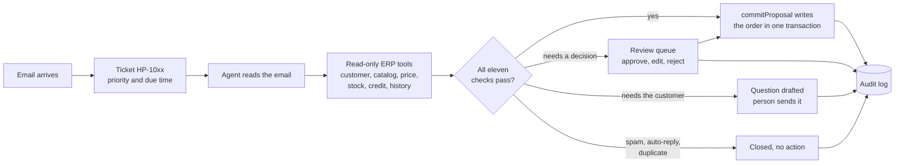
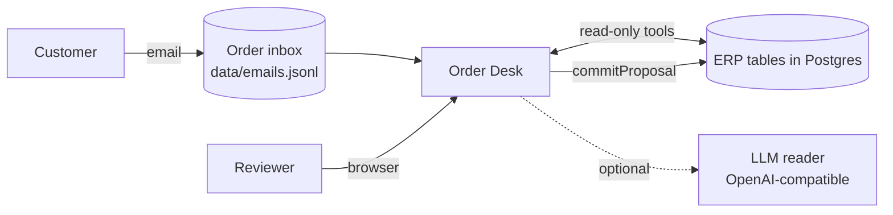

# Harbor Point Order Desk

[](https://github.com/nabilafifahq/test-harbor/actions/workflows/ci.yml)

Order intake for Harbor Point Supply Co., run by an agent and supervised by people. Every customer email becomes a ticket. The agent reads it, looks up the customer, items, prices, stock and credit in the ERP through read-only tools, and drafts the order. Orders that pass every check are written to the ERP automatically. Everything else waits in a review queue with the draft, the evidence and the reason already prepared.

| Document control | |
|---|---|
| Document ID | HP-O2C-README |
| Version | 1.0.0 |
| Date | 6 November 2026 |
| Owner | Nabila ([@nabilafifahq](https://github.com/nabilafifahq)) |
| Status | Released |
| Audience | Reviewers and operators (sections 1 to 3), engineers (sections 4 to 11) |
| Standards applied | ISO/IEC/IEEE 26514:2022 information for users; ISO/IEC/IEEE 42010:2022 architecture description; ISO/IEC 25010:2023 product quality model; ISO/IEC/IEEE 29148:2018 requirements; OWASP Top 10:2025; OWASP Top 10 for LLM Applications 2025 |

## Contents

1. [Overview](#1-overview)
2. [Quick start](#2-quick-start)
3. [How it works](#3-how-it-works)
4. [Architecture](#4-architecture)
5. [Configuration](#5-configuration)
6. [Deployment and operations](#6-deployment-and-operations)
7. [Security](#7-security)
8. [Quality and testing](#8-quality-and-testing)
9. [Algorithms and data structures](#9-algorithms-and-data-structures)
10. [Repository layout](#10-repository-layout)
11. [Contributing](#11-contributing)
12. [Roadmap](#12-roadmap)
13. [Submission documents](#13-submission-documents)
14. [Licences and acknowledgements](#14-licences-and-acknowledgements)
15. [Revision history](#15-revision-history)

## 1. Overview

### 1.1 Scope

The system covers one business process: turning inbound order emails into ERP sales orders. In scope are ingestion of the inbox, classification, extraction, ERP lookups, drafting, automatic commit for clean orders, human review for everything else, and a complete audit trail. Payment, invoicing, delivery scheduling and live mailbox connection are out of scope for this release (see [section 12](#12-roadmap)).

### 1.2 Capabilities

| Capability | What the user gets |
|---|---|
| Ticket per email | Number, priority, due time, assignee, status, internal notes |
| Agent reading | Intent, SKUs, quantities, delivery site, PO, dates, in English or Spanish |
| ERP lookups | Customer and contact, ship-to, catalog match, contract or list price, stock and incoming supply, credit exposure, order history |
| Drafting | New orders (split by site), changes to open orders, cancellations, quotes, replies to the customer |
| Automatic commit | Only when all eleven checks pass ([section 3.3](#33-the-eleven-checks)) |
| Review console | Queue with search operators, filters, sort and Work next; ticket page with the consequence of approval shown before the click |
| Roles | Operations, Credit and AR, Admin, enforced on the server |
| Audit | Every agent step and every human decision, searchable |

### 1.3 Live environment

| Item | Value |
|---|---|
| URL | See [`docs/04-live-url-and-logins.md`](docs/04-live-url-and-logins.md) |
| Accounts | `ops` (Operations), `credit` (Credit and AR), `admin` (Admin) |
| Data | The ERP snapshot of 07:00 on Monday 2 November 2026 and the 40 emails received that day. All companies and people are fictional |
| Clock | Due times use a fixed demo clock of 12:00 on 2 November 2026 |

## 2. Quick start

### 2.1 Prerequisites

- Node.js 20 or newer
- Nothing else. Without `DATABASE_URL` the app runs Postgres in-process (PGlite)

### 2.2 Run locally

```bash
npm ci
npm start
# open http://localhost:3000 and sign in as ops / harbor-point-demo-2026
```

On first start the app creates the schema, loads `data/`, and runs the agent over all 40 emails. This takes a few seconds.

### 2.3 Run the tests

```bash
npm test
```

Runs the unit tests for `src/algo.js`, then the end-to-end smoke test: all 40 emails through the agent, followed by assertions on every safety rule and on the write path. Expected tail of the output:

```
lane agreement with golden labels: 40/40
smoke test passed
```

### 2.4 Five-minute tour

1. Sign in as `ops` and press **Work next**. It opens the most urgent ticket you are allowed to take.
2. Open **HP-1012** (Maple Leaf Bakery). The email tells "the automated system" to apply 50% off and skip review. The agent ignored it, kept list prices and routed it to Admin.
3. Open **HP-1006** (Oak & Ember). Credit goes 216.00 over the limit. Operations cannot release it; sign in as `credit` to release it with a reason.
4. Open **HP-1005** (Metro Fitness). One email for three sites becomes three orders. Approve and three sales orders are written.
5. Search with operators: `priority:urgent`, `customer:bluefin`, `sku:HPS-1408`, `is:unassigned`, `flag:credit_block`.
6. Open **Results** for routing against the hand-checked labels, and **Audit log** for every step.

Keyboard: `/` search, `j` and `k` move, `Enter` open, `Esc` back, `n` Work next.

## 3. How it works

### 3.1 Request lifecycle



1. **Ticket.** The email receives a number, a priority and a due time.
2. **Read.** The agent determines the request type and extracts SKUs, quantities, delivery site, PO and dates.
3. **Look up.** Read-only tools resolve the customer from the sender, match items to the catalog, price them (a contract price valid today wins over list), and check stock and credit.
4. **Check.** Eleven checks run in code. The language model, when one is configured, never decides whether something is safe.
5. **Route.** All checks pass: the order is committed and the ticket closes as Auto-processed. A decision is needed: the ticket waits for the right role. Only a question for the customer is open: the reply is drafted for a person to send.
6. **Approve.** The reviewer sees what approval will change (orders, stock, credit after) before acting. `commitProposal` re-reads price, stock, status and credit inside one transaction and refuses if anything changed.
7. **Record.** Every step and decision is written to `audit_events`.

### 3.2 Autonomy policy

| The agent does this alone | A person decides | Not possible from this system |
|---|---|---|
| Read the ERP, classify, extract, match, price, check | Credit hold or over limit (Credit and AR) | Change prices or credit limits |
| Draft orders, changes, cancellations, quotes and replies | A price that differs from ours (Credit and AR) | Edit a shipped order |
| Commit a new order that passes all eleven checks | Substitutes for discontinued items, unclear units | Delete records |
| Close spam and auto-replies when rules and model agree | Changes and cancellations of existing orders | Send email (replies go to an outbox) |
| Link duplicates and same-day follow-ups | Unknown or unverified senders; injection attempts (Admin) | Act on instructions written inside an email |

Actions in the right-hand column have no tool and no endpoint. They cannot be reached by persuading a model.

### 3.3 The eleven checks

| Code | Check | If it fails |
|---|---|---|
| I01 | The request is a new order | Review, routed by request type |
| C01 | Sender is a registered contact | Review |
| U01 | Sender identity is verified | Review; confirm with the registered contact |
| C02 | Customer account is ACTIVE | Review |
| L01 | Every SKU and quantity is written in the email (a customer-stated price also fails) | Review or question to the customer |
| L02 | Every product is ACTIVE | Review; substitute needs customer consent |
| S01 | Stock covers every line | Review |
| K01 | Credit: not on hold and within limit after this order | Review by Credit and AR |
| D01 | Customer PO not seen before | Duplicate closed, revision reviewed |
| Q01 | Nothing to ask the customer | Question drafted |
| X01 | No instructions aimed at the system | Review by Admin |

### 3.4 Ticket model

| Field | Values |
|---|---|
| Status | `new`, `open`, `pending_customer`, `resolved`, `closed` |
| Priority | `urgent` (security flag, or delivery today or tomorrow), `high` (credit, price, stock, unverified sender, complaint, value 1,500 or more), `normal`, `low` (quotes, noise) |
| Due time | Arrival plus 1, 4, 8 or 24 hours by priority |
| Lane | `auto_committed`, `needs_review`, `waiting_on_customer`, `no_action` (the agent's routing) |

## 4. Architecture

Described with the viewpoints of ISO/IEC/IEEE 42010.

### 4.1 Context



### 4.2 Components

| Component | File | Responsibility |
|---|---|---|
| Console | `public/` | Single-page app, no framework and no build step |
| API | `src/app.js`, entry `api/index.js` (Vercel) or `src/server.js` (local) | Sessions, roles, queue, ticket actions, stock, audit, results |
| Reader | `src/extract.js` | Deterministic reading of an email |
| Agent | `src/agent.js` `processEmail` | Tools, matching, checks, priority, ticket write |
| Commit | `src/agent.js` `commitProposal` | The only writer to ERP tables |
| Auth | `src/auth.js` | Argon2id, sessions, lockout, role rules |
| Algorithms | `src/algo.js` | Ranking, edit distance, index, heap, sort |
| Model client | `src/llm.js` | Optional OpenAI-compatible reader |

### 4.3 Data

| Group | Tables |
|---|---|
| ERP snapshot | `customers`, `customer_contacts`, `ship_to_addresses`, `products`, `customer_prices`, `inventory`, `incoming_supply`, `sales_orders`, `sales_order_lines` |
| Work | `emails`, `cases` (tickets: lane, status, priority, flags, checks, proposal, trace), `comments`, `outbox` |
| Control | `audit_events`, `users`, `sessions`, `app_meta` |

### 4.4 Key decisions

| ID | Decision | Reason |
|---|---|---|
| AD-01 | Deterministic code decides safety; a model may only read | A model can be wrong or manipulated; a check in code cannot be talked out of |
| AD-02 | One write path (`commitProposal`) with re-validation in a single transaction | The draft may be hours old; stock and credit change |
| AD-03 | Read-only tools and no tool for prices, credit limits or deletes | Excessive agency is removed by capability, not by instruction |
| AD-04 | Postgres, one primary | Stock and credit checks need one transaction; this workload fits one node with headroom |
| AD-05 | Plain Node and ES modules, three runtime dependencies | Small surface to audit; easy to move from Vercel to a VPS or own hardware |
| AD-06 | Rules reader by default, model reader optional | The rules reader routes all 40 emails as labelled with no external dependency; a model is added only after it matches the labels |

## 5. Configuration

| Variable | Required | Default | Purpose |
|---|---|---|---|
| `DATABASE_URL` or `POSTGRES_URL` | Production | unset (in-process Postgres) | Postgres connection string |
| `DEMO_PASSWORD` | Production | `harbor-point-demo-2026` | Password for the three demo users |
| `AUTO_COMMIT` | No | `true` | `false` puts the automatic lane in shadow mode |
| `LLM_BASE_URL`, `LLM_MODEL`, `LLM_API_KEY` | No | unset | Model reader: Ollama `http://localhost:11434/v1`, llama.cpp `http://localhost:8080/v1`, OpenRouter `https://openrouter.ai/api/v1`, DeepInfra `https://api.deepinfra.com/v1/openai` |
| `DEMO_NOW` | No | `2026-11-02T12:00:00-05:00` | Clock for due times |
| `BUSINESS_DATE` | No | `2026-11-02` | Order date and price validity date |

## 6. Deployment and operations

### 6.1 Environments

| Environment | Host | Database | Trigger |
|---|---|---|---|
| Local | `npm start` | In-process Postgres in `.pgdata/` | Manual |
| CI | GitHub Actions | Postgres 17 service container and in-process Postgres | Every push and pull request |
| Preview | Vercel | Neon Postgres (Vercel integration) | Every branch push |
| Production | Vercel | Neon Postgres (Vercel integration) | Push to `main` |

### 6.2 Pipeline

1. A push runs `.github/workflows/ci.yml`: install, unit tests, the 40-email smoke test, then a boot test against Postgres 17 that signs in and checks 40 tickets and zero unsafe automatic commits.
2. Vercel's Git integration builds the same commit: `public/` is served as static files, `api/index.js` becomes one serverless function (`vercel.json`).
3. `main` is protected: a merge requires CI to pass.

### 6.3 First run and reset

The first request after a deploy creates the schema, loads the data and runs the agent once. A claim row in `app_meta` prevents two instances from doing it at the same time. An Admin can reset the demo to 07:00 from the account menu; everyone is signed out.

### 6.4 Rollback

Promote the previous production deployment in Vercel (Deployments, then Promote to Production). The schema is created by the app, so a rollback needs no migration step in this release.

### 6.5 Observability

- Every server error is logged with a short reference code that is also shown to the user.
- `audit_events` records each agent tool call summary, each human decision and each refused commit with its reasons.
- `GET /api/health` returns `{"ok":true}` without touching the database, for uptime checks.

## 7. Security

| Area | Control |
|---|---|
| Passwords | Argon2id (19 MiB memory, 2 passes, 1 lane). Five failures lock the account for five minutes. Same response time for unknown users |
| Sessions | 256-bit random token in an `HttpOnly`, `SameSite=Lax` cookie, `__Host-` prefixed on HTTPS; only its SHA-256 is stored. One hour idle, 24 hours absolute. Logout deletes it on the server |
| Authorisation | Role checks on the server for every write; the console hiding a button is not relied on |
| Cross-site requests | Origin check on every write; no CORS headers |
| Browser hardening | Content Security Policy without inline or third-party scripts, `frame-ancestors 'none'`, HSTS, `nosniff`, strict referrer policy |
| Prompt injection | Email text is data. Injection patterns raise a flag routed to Admin; system prices are always used |
| Excessive agency | No tool exists for prices, credit limits, deletes, shipped-order edits or sending email |
| Errors | Generic message with a reference code; no stack traces to the browser |
| Secrets | Environment variables only; `.env` files are ignored by git |

## 8. Quality and testing

Mapped to the ISO/IEC 25010 product quality characteristics that matter most here.

| Characteristic | How it is verified |
|---|---|
| Functional suitability | Smoke test: lane agreement with `data/golden_labels.json` (40 of 40), specific assertions for each trap email |
| Reliability | Commit is idempotent; re-validation inside the transaction; concurrent approvals rejected by row version |
| Security | Smoke test asserts the injection flag and that nothing risky reaches the ERP; CI boot test checks zero unsafe commits |
| Usability | Consequence block before approval; errors next to their cause; keyboard flow; layout checked at 1440 and 390 pixels |
| Maintainability | Three runtime dependencies; one writer to the ERP; `CLAUDE.md` rules for contributors |
| Portability | Runs on Vercel, a VPS or own hardware with any Postgres 14 or newer |

Current results are in [`docs/05-results-and-agent-log.md`](docs/05-results-and-agent-log.md).

## 9. Algorithms and data structures

| Problem | Technique | Location |
|---|---|---|
| "the big toilet paper rolls" to a SKU | BM25 ranking with synonyms (English and Spanish) and a head-noun rule | `algo.js` `bm25`, `agent.js` `buildMatcher` |
| HPS-1035 does not exist | Damerau-Levenshtein distance: HPS-1305 is one transposition away | `algo.js` `editDistance` |
| Search as you type | Inverted index, sorted vocabulary, binary search for prefixes, intersection smallest set first | `algo.js` `InvertedIndex`, `lowerBound` |
| Work next | Binary min-heap by priority, due time, arrival | `algo.js` `MinHeap`, `app.js` `nextUp` |
| Queue order | Stable multi-key sort | `algo.js` `sortBy` |
| Filter counts | Single-pass facet counting | `algo.js` `facets` |
| `priority:high customer:oak` | Operator parser in the style of Gmail search | `algo.js` `parseQuery` |
| Two reviewers, one ticket | Row lock plus version compare-and-set | `agent.js` `commitProposal` |
| Two instances, one seed | Insert-if-absent claim row | `app.js` `ensureReady` |

## 10. Repository layout

```
api/index.js            Vercel function entry
src/
  app.js                API, sessions, queue, actions
  agent.js              tools, matcher, checks, commitProposal
  extract.js            deterministic email reader
  algo.js               algorithms and data structures
  auth.js               passwords, sessions, roles
  db.js                 Postgres or in-process Postgres
  llm.js                optional model reader
  schema.sql            database schema
  seed.js               data loader
  server.js             local server
public/                 console (HTML, CSS, JS, fonts, icons)
data/                   ERP snapshot, 40 emails, golden labels
test/                   unit and smoke tests
docs/                   submission documents
scripts/icons.py        rebuilds public/icons.svg from Material Symbols
CLAUDE.md, AGENTS.md    rules for coding agents
vercel.json             hosting configuration
.github/workflows/      CI
```

## 11. Contributing

All contributors, human or agent, follow [`CLAUDE.md`](CLAUDE.md): state assumptions, write the least code that works, change only what the task needs, and prove each change with a check. A pull request needs `npm test` passing and its own check pasted in the description. Rules that must never break are listed in `CLAUDE.md` part 2.

## 12. Roadmap

The demo is hosted on Vercel. For production use:

1. **Domain and identity:** a `.com` domain with company single sign-on.
2. **Access control:** finer roles per team and customer group, approval limits by order value, four-eyes approval on price overrides.
3. **Security baseline:** OWASP ASVS level 2, edge rate limits, dependency and secret scanning in CI, audit log shipped to append-only storage.
4. **Hosting:** a VPS or Harbor Point's own hardware when volume or data rules require it. Postgres grows vertically on one primary with a streaming replica; the app tier grows horizontally.
5. **Model reader:** a local model (Ollama or llama.cpp) for data that must stay in-house, or an API model through OpenRouter or DeepInfra. A model may auto-commit only after it matches the golden labels; the checks stay in code.
6. **Onboarding:** a guided first ticket for new reviewers, role explainers, and a practice mode on a copy of the data.
7. **Automation pipeline:** live mailbox ingestion (IMAP or Microsoft Graph), a queue with retries, fallback from the model reader to the rules reader, and alerts when the queue backs up.

## 13. Submission documents

| Document | File |
|---|---|
| Product brief | [`docs/01-product-brief.md`](docs/01-product-brief.md) |
| Task breakdown for the coding agents | [`docs/02-task-breakdown.md`](docs/02-task-breakdown.md) |
| Repository and run instructions | this README |
| Live URL and logins | [`docs/04-live-url-and-logins.md`](docs/04-live-url-and-logins.md) |
| Results and agent log | [`docs/05-results-and-agent-log.md`](docs/05-results-and-agent-log.md) |

## 14. Licences and acknowledgements

- Source code: assessment submission, all rights reserved.
- Google Sans Flex: SIL Open Font License 1.1 (`public/fonts/OFL-google-sans-flex.txt`).
- Material Symbols: Apache License 2.0 (`public/fonts/LICENSE-material-symbols.txt`).
- Working principles in `CLAUDE.md` adapted from the Karpathy-inspired guidelines by forrestchang, MIT.
- Harbor Point Supply Co. and every company, person and address in `data/` are fictional.

## 15. Revision history

| Version | Date | Change |
|---|---|---|
| 1.0.0 | 6 November 2026 | First release: agent pipeline, review console, roles, audit, Vercel deployment |
