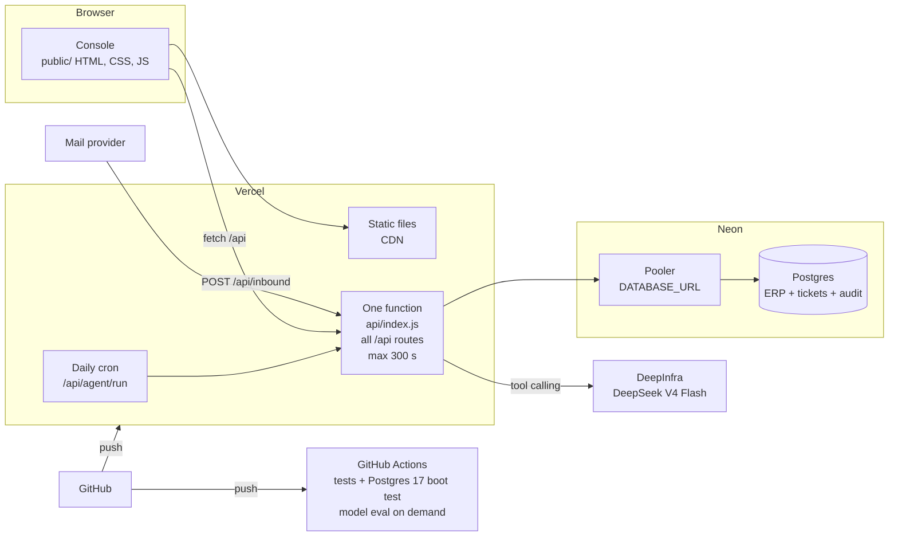
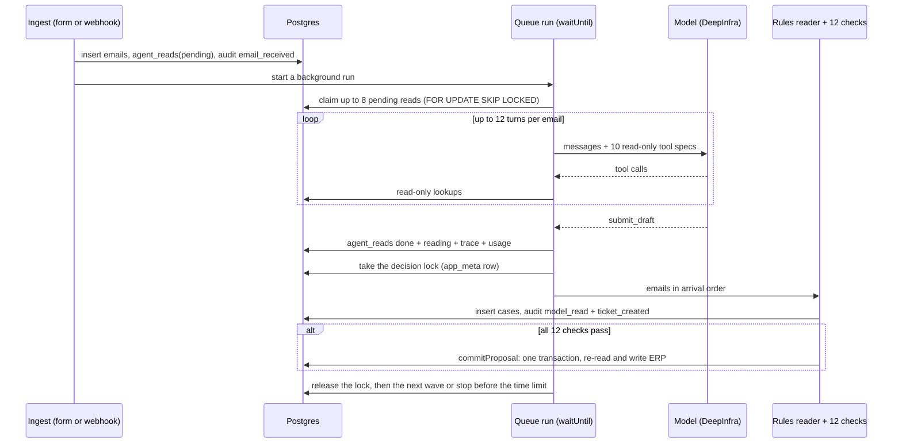
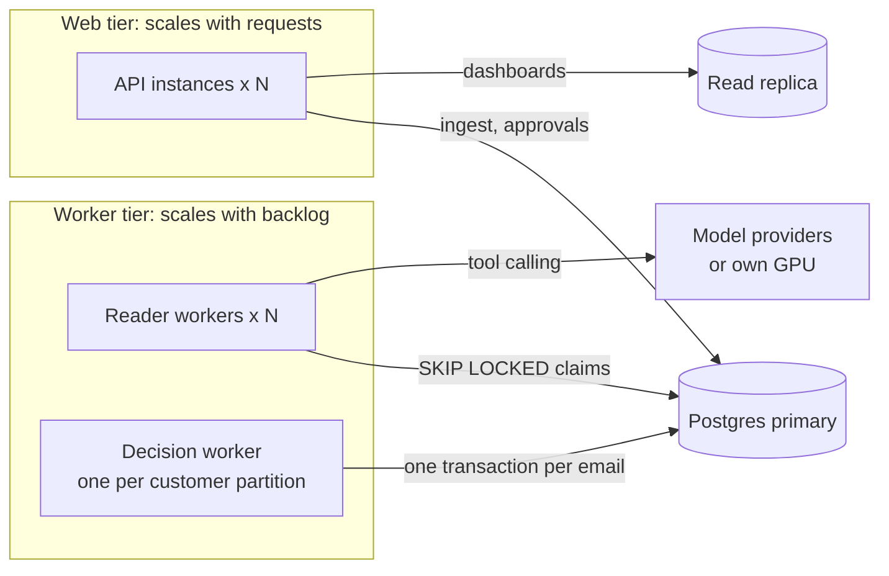

# Architecture and scaling

| Document control | |
|---|---|
| Document ID | HP-O2C-ARC-001 |
| Version | 1.1, 11 November 2026 |
| Owner | Nabila |
| Status | Draft for review |
| Related | README section 4 (summary architecture), `docs/07-database-writes.md` (writes per action) |
| Standards | ISO/IEC/IEEE 42010:2022 architecture description (views and decision records); ISO/IEC 25010:2023 performance efficiency and flexibility (scalability) |

This document describes the Order Desk as deployed today, records why each platform was chosen, and sets out how it grows: what to change, in which order, and what signal triggers each change. Figures marked *measured* come from runs of this code; figures marked *derived* are arithmetic on measured figures; vendor limits were read from the vendor's documentation on 11 November 2026 and change over time.

## 1. Views

### 1.1 Deployment view

Everything that runs is one Node process image with three runtime dependencies (`pg`, `@electric-sql/pglite`, `@node-rs/argon2`). Locally and in CI the same code runs against PGlite, which is Postgres compiled to WebAssembly, so tests exercise real SQL with no server to install.

### 1.2 Runtime view: one email

Two properties carry most of the design:

1. **Reading runs in parallel, deciding runs in order.** The model only reads, so emails can be read in any order and in parallel. Duplicates, stock and credit depend on what earlier emails did, so decisions run one email at a time in arrival order under a lock row.
2. **One writer to the ERP.** `commitProposal` is the only code that writes `sales_orders`, `sales_order_lines` and `inventory`. It locks the ticket, the customer and the stock rows, re-reads price, stock, status and credit, and refuses if anything changed since the draft.

### 1.3 Data view

| Group | Tables | Growth |
|---|---|---|
| ERP master | `customers`, `customer_contacts`, `ship_to_addresses`, `products`, `customer_prices`, `incoming_supply` | Loaded at seed; never written by the agent or a reviewer |
| ERP transactional | `sales_orders`, `sales_order_lines`, `inventory` | One order per delivery site per approved request |
| Work | `emails`, `agent_reads`, `cases`, `comments`, `outbox` | One `emails`, `agent_reads` and `cases` row per email |
| Control | `audit_events`, `users`, `sessions`, `app_meta` | Two to four audit rows per email from the agent, one per human action |

Measured on the 40 emails with the recorded DeepSeek run: about 15 KB of stored content per email (text and JSON before Postgres compression), and three quarters of it is the model's tool trace, kept twice (`agent_reads.trace` and `cases.trace`). Every table, column and action is listed in `docs/07-database-writes.md`.

## 2. Technology decisions

Continues the decision records AD-01 to AD-08 in README section 4.4.

### AD-09 Postgres as the only data store

**Decision.** ERP tables, tickets, the work queue, locks and the audit log all live in one Postgres database.

**Why.** The safety rules are transactional: an order may be written only if stock and credit still hold at that instant, and two reviewers must not write the same ticket twice. Postgres gives this with row locks (`SELECT ... FOR UPDATE`), a check constraint that stops `inventory.available` going below zero, and a version compare on the ticket. The same engine also gives a work queue (`FOR UPDATE SKIP LOCKED`) without a message broker, and `jsonb` for drafts, flags and traces, which change shape as the agent improves. PGlite runs the identical SQL in tests.

**Alternatives considered.** A document store such as MongoDB or Firestore would hold drafts well but makes the stock and credit transaction harder to reason about. SQLite allows one writer and has no network server for a serverless function. MySQL 8 would work (it has `SKIP LOCKED`); Postgres won on `jsonb`, a serverless host with a free tier and an in-process build for tests.

**Change it when** the audit and trace history outgrow one database. Section 3 covers partitioning and archiving first; splitting the database comes after those.

### AD-10 Neon as the Postgres host

**Decision.** Neon through the Vercel integration, one database for Production and Preview.

**Why.** Neon is plain Postgres that scales compute to zero when idle, so a demo that is used for a few hours a week costs nothing in between. The Vercel integration sets `DATABASE_URL`, which goes through Neon's PgBouncer pooler; the app reads that variable first. A serverless function opens new connections often, and the pooler accepts up to 10,000 client connections while sharing a small set of server connections. Moving off Neon is a `pg_dump` and a new connection string.

**Limits that matter.** Free plan: 100 CU-hours per project per month, autoscaling up to 2 CU (8 GB RAM), 1 GB storage per project, scale to zero after 5 minutes that cannot be switched off (the first query after a pause waits for compute to start). Launch plan: autoscaling up to 16 CU at USD 0.106 per CU-hour. Scale plan: fixed sizes up to 56 CU at USD 0.222 per CU-hour. Storage USD 0.35 per GB-month on both. The design already respects the free-plan compute budget: nothing polls the database while the queue is empty (lesson 3 in `docs/05`).

**The code is pooler-safe.** Transaction pooling breaks session features. The app uses none: locks are rows in `app_meta`, not advisory locks; there is no `LISTEN`, no session `SET`, and `pg` sends unnamed statements.

**Alternatives considered.** Supabase is also Postgres but brings auth, storage and an API layer this app does not use. AWS RDS or Cloud SQL run all the time and need more setup for a demo. Self-hosted Postgres is the cheapest at steady volume and is the natural target for an on-premise install (product brief, last section).

### AD-11 Vercel for hosting and deployment

**Decision.** Static console on Vercel's CDN, all API routes in one Vercel Function, Git integration for deploys.

**Why.** A push to a branch builds a preview URL; a push to `main` goes to production; rollback is promoting the previous deployment. The same project serves static files, the function, the daily cron and `waitUntil` for background work. For a reviewer this means a working URL with no infrastructure to explain.

**Limits that matter.** Hobby is for non-commercial personal use only. Function duration is 300 seconds on Hobby (Pro: 800 seconds, 1,800 in beta); memory 2 GB with 1 vCPU (Pro: up to 4 GB with 2 vCPU). Cron jobs run at most once a day on Hobby, within the hour; Pro allows once a minute. The queue was built around these limits: each run stops before 300 seconds, starts the next run itself, and the daily cron is only a backstop.

**Lock-in.** Vercel appears in `vercel.json`, the 6-line `api/index.js` adapter, the `waitUntil` lookup and the self-chaining URL in `src/app.js`. `src/server.js` runs the same app as a plain Node server, so a VPS or a container platform needs no change to the domain code, only a process that runs the queue (section 3.3).

### AD-12 No Next.js and no front-end framework

The console is plain HTML, CSS and ES modules served as static files, and the API is a plain Node HTTP handler. Next.js is not used.

**Why.** The console is one signed-in single-page app with no public pages, so server rendering and SEO buy nothing. The hard parts of this system are the queue, the transaction and the checks, and none of them is helped by a UI framework. With no build step, what runs is exactly what is in the repository, which keeps review and debugging short. It also holds the rule of three runtime dependencies in `CLAUDE.md`.

**Adopt Next.js when** the UI grows past what one person keeps in their head: a customer-facing portal that needs server rendering, many screens shared by a front-end team, or a component library. The path is to keep the API as it is and build the new front end against it, or to move handlers into Next.js route handlers one by one. Nothing in the domain code depends on how pages are rendered.

### AD-13 DeepSeek V4 Flash on DeepInfra behind an OpenAI-compatible client

**Decision.** `src/llm.js` speaks the OpenAI chat format with tool calling. DeepInfra and DeepSeek V4 Flash are the default; Ollama, llama.cpp, vLLM or OpenRouter work by changing `LLM_BASE_URL` and `LLM_MODEL`.

**Why.** It reads all 40 emails correctly enough that the checks route 40 of 40 as labelled, at about USD 0.001 per email (measured, `docs/05`). The provider limit is on concurrency, 200 requests in flight per model per account by default, with no per-minute cap; a higher limit is requested from the DeepInfra dashboard.

**Swap it** by running `npm run eval` against the new model first. A model is accepted only if routing stays 40 of 40 and nothing unsafe is written.

## 3. Scaling

### 3.1 Where the time and money go today

| Step | Per email | Source |
|---|---|---|
| Model reading (tool loop) | 14.3 s average, 55.2 s slowest; 4.4 model calls; 12,092 input and 1,298 output tokens | Measured, recorded run of 7 November (`data/model-run/`) |
| Model cost | USD 0.00096 average, 0.0023 highest | Measured, same run |
| Checks, ticket write and auto-commit | 16 to 20 ms median, 51 to 70 ms 95th percentile | Measured locally on PGlite, four runs |
| One human approval (`commitProposal`) | 20 to 23 ms | Measured locally on PGlite |
| 40 emails end to end, 8 read in parallel | 135 to 156 s | Measured, three eval runs in GitHub Actions |

The model step is about 700 times slower than the decision step measured locally. Throughput is set by how many emails are read at once, and cost is set by tokens. On Neon each query adds a network round trip, so the decision step will be slower than the local figure, still far from the model's seconds.

*Derived:* one run reading 8 at a time handles about 920 to 1,070 emails an hour. At the default DeepInfra limit of 200 requests in flight, and 14.3 seconds per email, the provider ceiling is about 50,000 emails an hour. Model cost is about USD 1 per 1,000 emails. Storage is about 1.5 to 2 GB per 100,000 emails at today's trace size, so the Neon free plan's 1 GB holds roughly 50,000 to 60,000 emails.

### 3.2 Vertical scaling

Making each part bigger. This is the first move for every layer because it changes no code.

| Layer | How | Limit | Signal to do it |
|---|---|---|---|
| Postgres (Neon) | Raise the autoscaling maximum: 2 CU on Free, 16 CU on Launch, fixed up to 56 CU on Scale | 56 CU (224 GB RAM) | CPU near the autoscaling maximum; decision step p95 rising |
| Function (Vercel) | Pro plan: 4 GB and 2 vCPU, duration up to 800 s | 4 GB, 2 vCPU, 800 s (1,800 s in beta) | Runs hitting the time limit; list pages slow |
| Model reading | Raise `AGENT_CONCURRENCY` (8 today) | 200 in flight per model by default, more on request | Queue backlog at peak; time from email to ticket |
| Model quality per call | A larger model in the fallback chain, scored with `npm run eval` first | Cost per email | More disagreements between the readers (check M01) |

### 3.3 Horizontal scaling

Adding more copies. The web tier and model reading scale out today, and concurrent new mail and approvals are safe since rows 1 to 3 of section 3.4 were fixed. Decisions stay on one worker until row 6 is done.

| Layer | How it scales out | Ready today? |
|---|---|---|
| Web and API | Vercel runs more function instances as requests grow; each keeps a pool of 5 connections (`PG_POOL_MAX`) through the Neon pooler | Yes |
| Model reading | Several runs claim different emails with `FOR UPDATE SKIP LOCKED`; a run whose claim expires after 5 minutes is reclaimed | Yes |
| Model provider | Comma-separated `LLM_MODEL` list across models or providers, each with its own concurrency limit | Yes, as fallback; a load-sharing router is a small change |
| Decisions | One worker at a time under the `lock:process` row | No. Partition by customer (section 3.4, row 6) when the decision step becomes the bottleneck |
| Reads for dashboards | Neon read replicas (3 per project on Free) for results, audit and stock pages | Needs a second connection string for read-only queries |
| Background work | Today: `waitUntil` plus self-chaining plus a daily cron. At volume: a long-running worker process on a container platform or VPS, polling only while work exists, or a managed queue | Worker loop exists (`runAgentQueue`); needs a host |

### 3.4 What breaks first, and the change for each

Found by reading the code against higher volume. None affects correctness at today's load. Rows 1 to 3 failed requests that arrived at the same moment; they were fixed on 11 November 2026, and `test/concurrency.test.mjs` runs each race against Postgres 17 in CI. Before the fix, eight new emails at once failed with a duplicate email ID, two approvals at once with a duplicate SO number, and two approvals sharing SKUs in opposite order with a deadlock.

| # | Where | Today | What breaks | Change |
|---|---|---|---|---|
| 1 | Email ID (`ingest` in `src/app.js`) | Fixed: number from the sequence `email_seq` (was count of emails + 1); `Message-ID` stored with a unique index, so a repeat delivery returns the existing ticket | Nothing at volume | Done |
| 2 | SO number (`commitProposal`) | Fixed: number from the sequence `so_number_seq` (was highest SO number + 1) | Nothing at volume. A commit refused by the credit check after it took a number leaves a gap in the SO numbers | Done |
| 3 | Stock row locks (`commitProposal`) | Fixed: every inventory row of the commit locked first, in SKU order (was line by line in the order of the draft) | Nothing at volume. Two commits that share SKUs run one after the other | Done |
| 4 | Ticket list (`listTickets`) | Loads every ticket, with the email body, on each request; filters, search and counts in memory | Response time grows with every ticket ever received | Filters, sort and keyset pagination in SQL; Postgres full-text search (`tsvector` with a GIN index) or `pg_trgm`; counts by `GROUP BY`; closed tickets out of the default query |
| 5 | Model waves (`runAgentQueue`) | Claims 8, waits for all 8, claims the next 8 | A wave waits for its slowest email (55 s against a 14 s average) | Continuous worker pool: claim the next email as soon as one finishes. *Derived:* close to twice the throughput at the same concurrency |
| 6 | Decision lock | One worker for all customers | Becomes the limit only at very high volume (decision step is milliseconds) | Lock per customer: credit and duplicate POs depend only on the same customer; stock is already protected by row locks in the commit |
| 7 | Product matcher (`buildMatcher`) | BM25 index over the whole catalog built in memory per run | Build time and memory grow with a catalog of tens of thousands of SKUs | Cache per instance and rebuild on catalog change, or move matching to Postgres full-text search |
| 8 | Traces and audit | Full tool trace stored twice per email; audit grows forever | Storage and backup size | Keep the trace once; partition `audit_events` and `agent_reads` by month; move traces older than the retention period to object storage |
| 9 | Demo settings | `MAX_EMAILS` 300, fixed clock `DEMO_NOW` and `BUSINESS_DATE`, received time set from the demo clock | Not valid outside the demo | Remove for production; use the mail's real receive time |
| 10 | Triggers on Hobby | Cron once a day | A stalled run waits until the console is opened or the next day | Pro cron every minute, or the worker process in section 3.3 |

### 3.5 Stages

Each stage starts when its signal appears.

| Stage | Load it is built for | Platform | Code changes |
|---|---|---|---|
| 0, today | One inbox, 40 emails a day, a demo | Vercel Hobby, Neon Free, DeepInfra default limits | None |
| 1, first real team | One company's order desk; paying use | Vercel Pro (Hobby forbids commercial use), Neon Launch, cron every minute | Rows 9 and 10 of section 3.4; direct mailbox connection; single sign-on |
| 2, more volume | Backlog at peak hours, list pages slowing | Worker process on a container platform or VPS next to the web tier; read replica for dashboards | Rows 4, 5, 7 and 8; queue depth and age alerts; dead-letter view |
| 3, several companies | More than one customer of the product | Tenant ID on every row with Postgres row-level security, or one Neon project per tenant | Per-tenant queues and model budgets; row 6 |

## 4. Scaling the agent

### 4.1 Throughput and cost

- **Concurrency** is the main dial: `AGENT_CONCURRENCY` per run, more runs in parallel, and the provider's in-flight limit above both. Each email holds one request at a time because the tool loop is sequential, so emails in flight equals requests in flight.
- **Tokens per email** set the cost. Most of the 12,000 input tokens per email are the same instructions, tool specs and earlier tool results sent again on each of the 4 or 5 calls. Shorter tool results, provider-side prompt caching where offered, and fewer turns cut cost without touching the checks.
- **Spreading load across models.** The `LLM_MODEL` list is a fallback chain today. Routing a share of traffic to a second provider or a local model through `LLM_BASE_URL` gives more capacity and keeps working when one provider is down. A local model on own hardware is bounded by GPU throughput instead of a provider limit, and keeps email text in-house.

### 4.2 Quality as volume grows

- Every model change goes through `npm run eval` against the labelled emails, and the eval job keeps every run on the `eval-results` branch.
- New automatic lanes start in shadow mode (`AUTO_COMMIT=false`), as the product brief sets out, and are switched on after the weekly labelled sample reaches 95% agreement.
- A second model as the cross-checking reader, in place of the rules reader, is the change most likely to raise the share written without a person: today the two readers disagree on 7 of 37 emails where the model reads more than the rules can (`docs/05`).

### 4.3 More agents, same safety boundary

New agents are added only when a new job appears. Each one gets read-only tools and a `submit` tool; plain code still decides, and `commitProposal` stays the only ERP writer.

| Agent | Job | Writes |
|---|---|---|
| Order reader (today) | Read the email, look up the ERP, draft the request | `agent_reads`, then code writes `cases` |
| Attachment reader | Read PDF and spreadsheet purchase orders (E023 today asks for the PO again) | Draft lines for the order reader's ticket |
| Reply drafter | Draft the customer reply for each lane | `outbox` draft; a person sends it |
| AR assistant | Draft credit notes and invoice answers for Credit and AR | Draft only; AR system stays manual |

Keying the reads table by email and agent lets every agent reuse the existing claim, retry and fallback logic.

### 4.4 Letting other agents use this system

The ten read-only tools in `src/model-agent.js` (customer, ship-to, catalog search, price, stock, credit, orders, history) can be served as an MCP server. Another agent, for example an assistant the sales team already uses, could then answer "do we have HPS-1305 in stock for Oak and Ember" from the same source of truth. Writes stay behind the existing approval API with its server-side role checks, so an outside agent can propose but never commit.

## 5. Prepared answers

**Why Postgres and not a NoSQL database?** The rule that matters most, never write an order that stock or credit cannot cover, is a transaction across several rows. Postgres does that with row locks and constraints, and the same database also serves as the work queue and holds the drafts as JSON. One store means one backup and one place to look.

**Why Neon?** It is ordinary Postgres that costs nothing while idle, has a pooler that suits serverless functions, and the Vercel integration sets the connection string for us. Nothing in the code is Neon-specific; moving is a dump and a new connection string.

**Why Vercel, and is it fit for production?** It gave a deployed URL, preview builds per branch and rollback with no infrastructure work. For production it needs the Pro plan, because Hobby is non-commercial only and limits cron to once a day. At higher volume the background worker moves to a long-running process; the web tier can stay on Vercel or move with it.

**Why not Next.js?** The console is one signed-in app with no public pages, so server rendering adds nothing, and the difficult parts of the system are the queue and the transaction. Plain modules keep the dependency count at three and remove the build step. If a customer-facing portal or a larger front-end team arrives, Next.js can be built against the same API.

**How does it scale vertically?** Bigger Neon compute (up to 16 CU autoscaling, 56 CU fixed), larger Vercel functions on Pro, and more emails read at once. None needs a code change.

**How does it scale horizontally?** Model reads already scale out: any number of runs can claim different emails safely. The web tier scales by request. Decisions run one at a time on purpose; they take milliseconds, and when they become the limit they can be split by customer.

**What breaks first at ten times the load?** The ticket list, which reads every ticket on each request (section 3.4, row 4). Three races used to fail requests that arrived together: duplicate email IDs, duplicate SO numbers, and lock order in the commit. They never wrote anything wrong, and they were fixed on 11 November 2026 with two sequences and sorted stock locks, each race tested against Postgres 17 in CI.

**What if the model provider is slow, down or rate-limited?** The client retries once on 429 and 5xx. A failed reading is retried once more, then the rules reader takes over and the ticket waits for a person; nothing is written automatically without the model. A second model in `LLM_MODEL` is tried before the rules reader.

**How much does it cost?** About USD 0.001 of model time per email (measured). Hosting is free at demo scale; a first production setup is Vercel Pro (USD 20 per developer seat per month) plus Neon Launch billed by compute hours used.

**What about much more data?** About 15 KB per email today, mostly traces. Keep the trace once, partition audit and reads by month, archive old traces to object storage, and serve dashboards from a read replica.

**Two reviewers approve the same ticket at once?** The commit locks the ticket row, so the two run one after the other. The second finds the ticket already written and gets the first result back. If the ticket changed in another way after it was opened, such as an edit or a reassignment, the version the console sent no longer matches and the reviewer is asked to reload. The order is written once.

**Can other agents connect to it?** Yes, through the read-only tools served as an MCP server; any write still goes through approval with server-side role checks (section 4.4).

## 6. Sources

- Neon plans and limits: https://neon.com/docs/introduction/free-tier
- Neon pooler and connection limits: https://neon.com/faqs/postgres-serverless-functions-connection-issues
- Neon Vercel integration variables: https://neon.com/docs/guides/neon-managed-vercel-integration
- Vercel Hobby plan: https://vercel.com/docs/plans/hobby
- Vercel function limits: https://vercel.com/docs/limits
- Vercel cron limits: https://vercel.com/docs/cron-jobs/usage-and-pricing
- DeepInfra rate limits: https://docs.deepinfra.com/account/rate-limits
